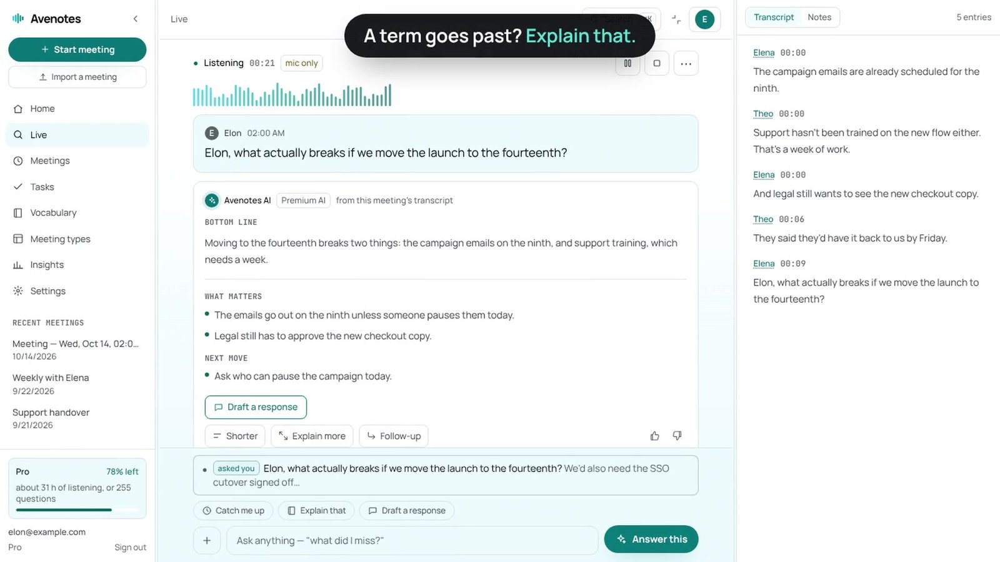
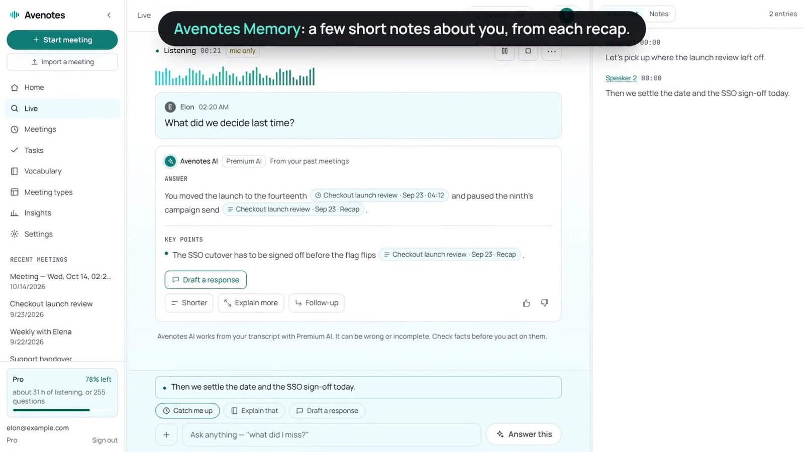
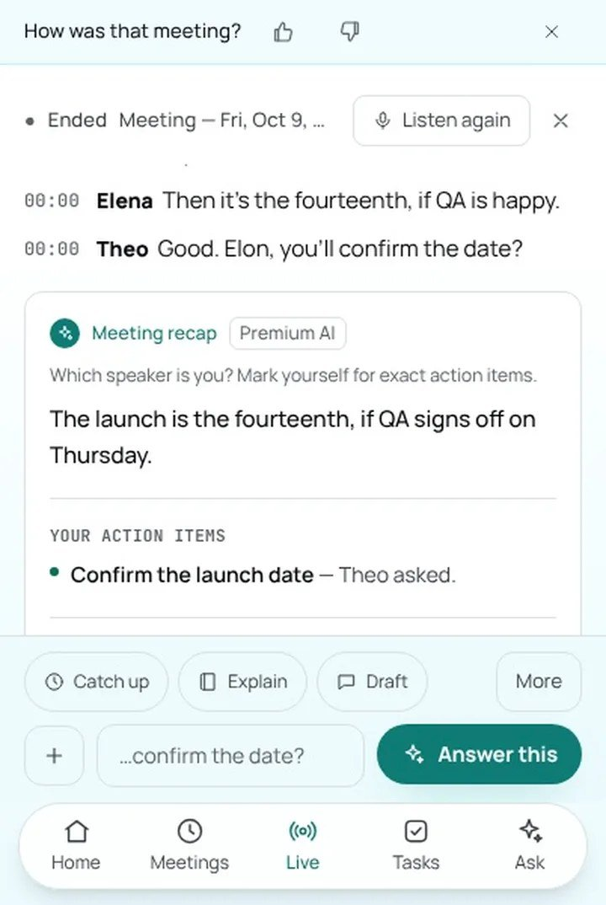

# Sang Thai — AI Solution and Data Engineer 👋

### **AI Solution and Data Engineer** · M.S. candidate in AI and Digital Transformation @ USF — I build pipelines that hold up in production, and AI systems on top of them.

  
  
  

  
  
  
  

---

### About me

At **Citi** I was the sole developer behind **ATLAS**, a controls-testing platform architected for **~25M records/month** across 52 payment applications, built in partnership with Operational Risk stakeholders. It validated locally end-to-end before a reorg shifted priorities.

I came up through data — Finance degree from USF, then Wells Fargo and Raymond James doing SQL-heavy operations and pipeline work (schema design, Control-M batch scheduling) — and taught myself software engineering properly along the way: Python → data pipelines → backend APIs → cloud infrastructure → applied AI. Now formalizing it with an **M.S. in AI in Business & Enterprise Integration** (expected Dec 2027).

My edge: I don't just move data, I make it *usable* — RAG pipelines, verifiable document extraction, and analytics layers teams actually query.

  
  

---

## 🚀 Featured Projects

### 🎙️ avenotes.ai — [Live site →](https://avenotes.ai)

**Shipped SaaS: AI meeting notes without the bot.**

Browser-based meeting note-taker — no bot joins the call. Live transcription, structured recaps, cross-meeting memory. Designed, built, and launched.

  

  
  

---

### 📊 [Automated Portfolio Analytics Pipeline](https://github.com/thaisangcr7/Automated-Portfolio-Analytics-Pipeline)

**End-to-end ELT: Yahoo Finance → PostgreSQL → dbt → Metabase, orchestrated by Airflow.**

Daily stock prices flow through a medallion architecture — Bronze (raw, append-only) → Silver (cleaned, enriched) → Gold (marts) — with data quality tests gating every run.

| | |
|---|---|
| ⏰ Orchestration | Airflow DAG, weekdays 6 PM: ingest → seed → dbt run → test |
| 🥉🥈🥇 Modeling | 5 dbt models across three layers · **26 data quality tests** |
| 📈 BI | Metabase dashboard: value, P&L, moving averages |
| 🐳 Infra | Fully containerized in Docker |

  

---

### 🥑 [Avocado](https://github.com/thaisangcr7/avocado)

**Grounded AI over your team's data.**

A copilot that answers from documents with cited sources — or writes Python, runs it against your data in a locked-down sandbox, and shows you the code behind the number. Handles **110,000+ row** datasets.

`Python` `FastAPI` `PostgreSQL` `pgvector` `Redis` `Docker` `React` `TypeScript` — **757 tests · CI green**

  

---

### 🔎 [credit-rag](https://github.com/thaisangcr7/credit-rag)

**Verifiable RAG for financial documents.**

Extracts structured terms from 200+ page credit agreements — every value traced to its source sentence; unverifiable values return **not found**, never hallucinated. Two-stage retrieval (pgvector + local cross-encoder), Kafka-backed idempotent ingestion, eval harness included (**64 tests · CI green**).

---

### 📡 [SENTINEL](https://github.com/thaisangcr7/SENTINEL)

**Production-grade data pipeline on AWS.**

Economic indicator monitoring (FRED API → PostgreSQL → anomaly alerts via FastAPI). Infrastructure fully defined in Terraform, deploys gated on the test suite, security-audited before launch (**6 vulnerabilities fixed**), ran live on AWS for five months.

---

## 🧰 Tech Stack

  

| Area | |
|---|---|
| **Data** | Airflow · dbt · Kafka · PostgreSQL · pgvector · SQL Server · Pandas · Metabase |
| **AI** | RAG · Vector search · Cross-encoder reranking · Eval harnesses · Sandboxed code execution · Claude API · Deepgram |
| **Backend** | FastAPI · Flask · ASP.NET Core · REST · WebSockets · async Python |
| **Infra** | Docker · Kubernetes · Terraform · AWS · Azure · GitHub Actions · CI/CD |

---

## 📈 By the numbers

| | |
|---|---:|
| Records/month ATLAS was architected for | **~25M** |
| Manual effort it was designed to remove | **~90%** |
| Payment applications covered | **52** |
| dbt models / data quality tests | **5 / 26** |
| Avocado automated tests | **757** |
| Largest dataset computed in full | **110,064 rows** |

---

## 📬 Currently

- 📊 Building data systems that hold up in production
- 🎙️ Growing **avenotes.ai**
- 🎓 M.S. in AI & Digital Transformation @ USF
- 💼 Open to **Data Engineering, AI Engineering, and Frontend/Backend** roles — [let's talk](mailto:thaisangcr7@gmail.com)
- ⚽ Playing soccer whenever I can

---

🌐 [sangthai.dev](https://sangthai.dev) · 💼 [LinkedIn](https://www.linkedin.com/in/sang-thai/) · 📧 thaisangcr7@gmail.com

